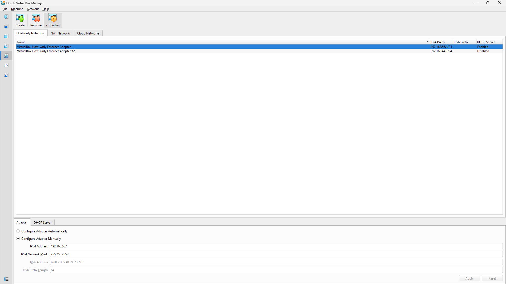
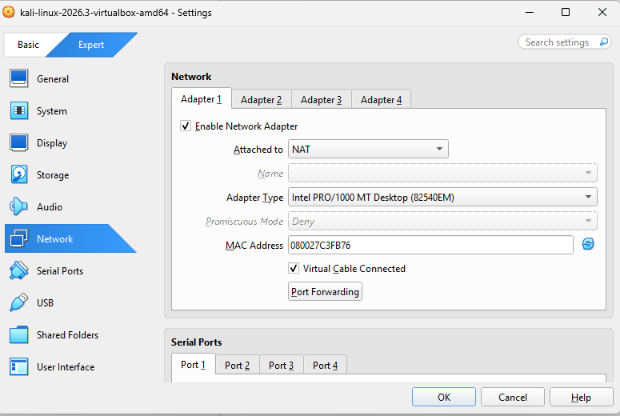
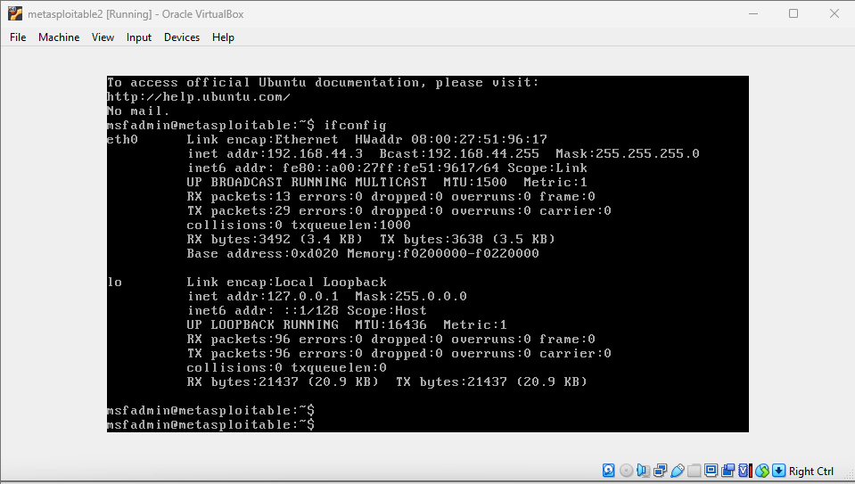
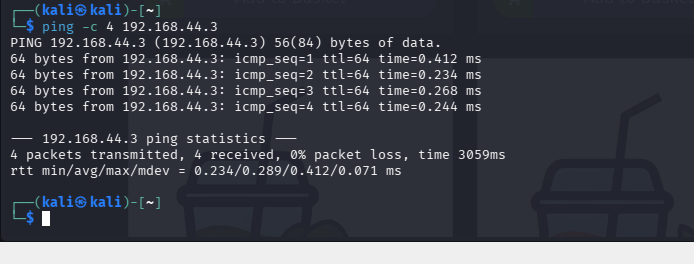

# Phase 1: Lab Setup

## Objective
Build an isolated penetration testing lab.

## Environment
| Machine | Role | OS | IP |
|---|---|---|---|
| Kali Linux 2026.3 | Attacker | Debian 64-bit | 192.168.44.x |
| Metasploitable 2 | Target (network) | Ubuntu 8.04 | 192.168.44.3 |
| OWASP Juice Shop | Target (web) | Docker on Kali | localhost:3000 |

## Network
- Hypervisor: VirtualBox
- Kali: Adapter 1 NAT, Adapter 2 Host-only (#2)
- Metasploitable: Host-only only (#2), isolated from the internet
- DHCP range: 192.168.44.3 – 192.168.44.254

## Steps
1. Installed VirtualBox 
2. Configured host-only network + DHCP 
3. Imported Kali, set network adapters 
4. Created Metasploitable VM, obtained IP 
5. Deployed Juice Shop with Docker 
6. Verified connectivity 
7. Baseline Nmap scan 
