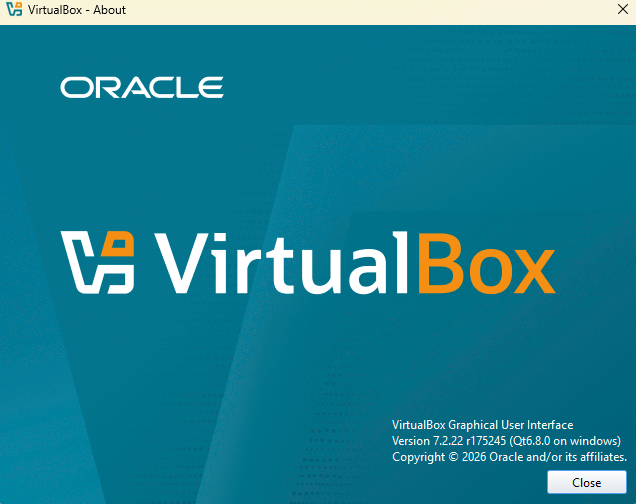
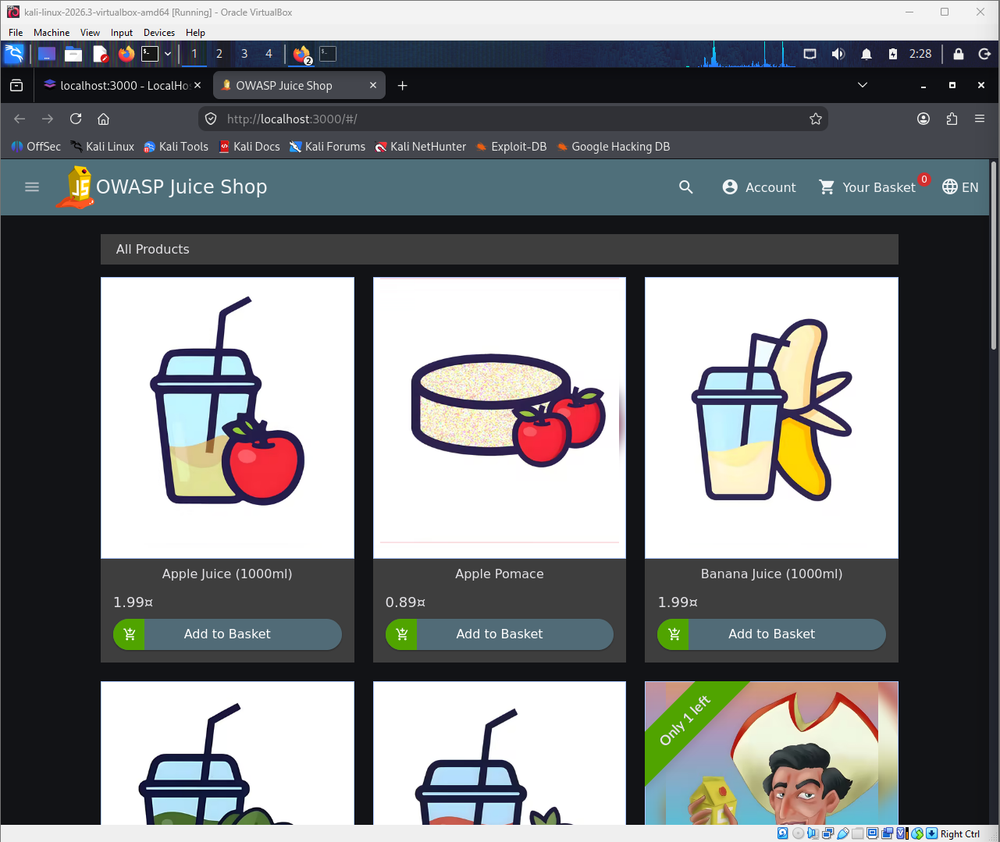
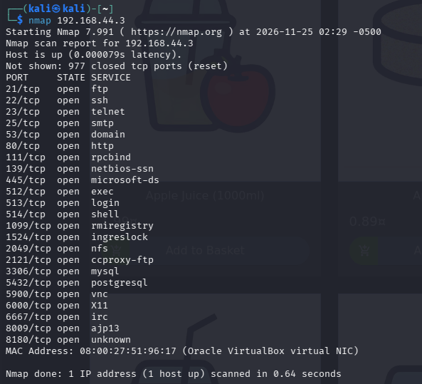

1. Installed VirtualBox 
2. Configured host-only network + DHCP 
3. Imported Kali, set network adapters 
4. Created Metasploitable VM, obtained IP 
5. Deployed Juice Shop with Docker 
6. Verified connectivity 
7. Baseline Nmap scan 
